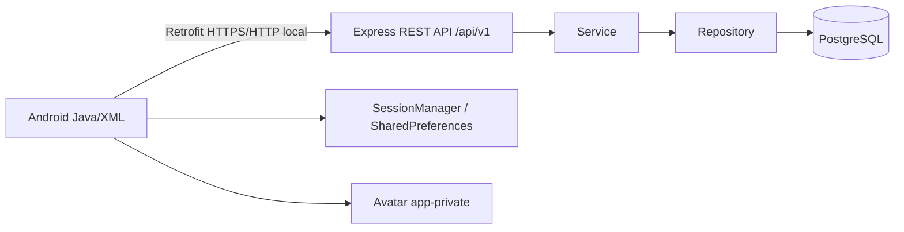

# M13.8 — Quiz Quality & Online-Only Architecture

**Trạng thái:** DONE  
**Ngày nghiệm thu:** 2026-10-23  
**Database vận hành:** `flashcard_english` (chỉ đọc trong M13.8)  
**Thiết bị nghiệm thu:** Android Emulator Pixel 6, API 35, `emulator-5554`

## 1. Phạm vi thực hiện

M13.8 chuyển luồng học của Android sang Online-Only và cải thiện bộ sinh Quiz cho kho 5.000 Flashcard. Không chạy migration, không import dataset, không ghi dữ liệu kiểm thử vào database vận hành và không triển khai chức năng M14.

Luồng dữ liệu hiện tại:



Room không còn nằm trong source set, dependency hoặc luồng runtime. SessionManager, JWT, SharedPreferences, avatar và dữ liệu cá nhân vẫn được giữ nguyên.

## 2. Thay đổi Backend Quiz

- Repository Quiz tải thêm `part_of_speech` và `level` để xếp hạng đáp án nhiễu.
- Chỉ dùng Flashcard active và đáp ứng quy tắc provenance/`quiz_eligible` hiện có.
- Loại câu hỏi có cùng English chuẩn hóa nhưng trỏ tới nhiều nghĩa trong cùng chủ đề.
- Chuẩn hóa Unicode và tách các thành phần nghĩa tiếng Việt theo dấu `, ; / |`; loại đáp án nhiễu có thành phần nghĩa trùng với đáp án đúng hoặc nhau.
- Ưu tiên đáp án nhiễu cùng POS, sau đó cùng CEFR; vẫn yêu cầu đủ bốn lựa chọn an toàn.
- Không lặp prompt hoặc Flashcard trong một lần sinh Quiz.
- Khi chủ đề thiếu dữ liệu, API trả chính xác số câu an toàn: `Only X safe quiz question(s) are available; Y requested`.
- Android chuyển lỗi này thành thông báo tiếng Việt có số lượng khả dụng.

Không tự mở eligibility của toàn bộ 5.000 thẻ. Số thẻ đạt điều kiện provenance hiện tại vẫn là **926**; sau khi loại prompt đa nghĩa và các bộ đáp án không thể tạo ba nhiễu an toàn, có **851** câu hỏi an toàn theo tổng từng chủ đề.

## 3. Kết quả audit Quiz production

Audit chỉ đọc chạy 25 lần lấy mẫu cho mỗi chủ đề có dữ liệu. Mỗi lần lấy tối đa 10 câu. Kết quả toàn bộ mẫu: 0 ID câu hỏi trùng, 0 prompt trùng, 0 câu sai số lượng lựa chọn, 0 ID lựa chọn trùng và 0 nghĩa lựa chọn trùng.

| Chủ đề | Eligible nguồn | Câu an toàn |
|---|---:|---:|
| ANIMALS | 30 | 30 |
| CULTURE | 18 | 18 |
| DAILY_LIFE | 54 | 54 |
| EMOTIONS | 1 | 0 |
| FAMILY | 44 | 34 |
| FOOD | 81 | 69 |
| HEALTH | 53 | 47 |
| HOME | 56 | 56 |
| LEISURE | 63 | 63 |
| PERSONAL | 48 | 48 |
| RELATIONSHIPS | 5 | 5 |
| SCIENCE | 0 | 0 |
| SCHOOL | 125 | 115 |
| SHOPPING | 104 | 96 |
| TECHNOLOGY | 44 | 42 |
| TRANSPORTATION | 7 | 7 |
| TRAVEL | 60 | 48 |
| WEATHER | 34 | 32 |
| WORK | 99 | 87 |
| **Tổng** | **926** | **851** |

Các chủ đề EMOTIONS, RELATIONSHIPS, SCIENCE và TRANSPORTATION không đủ 10 câu. Backend không lặp hoặc tạo câu giả; API báo đúng số lượng khả dụng.

## 4. Android Online-Only

- `TopicRepository` và `FlashcardRepository` gọi Retrofit trực tiếp; lỗi mạng được trả về UI, không đọc Room fallback.
- `VocabularyRepository` và `QuizRepository` dùng cùng thông báo kết nối chuẩn.
- Topics, Flashcard và Search có loading/error/retry rõ ràng. Nội dung cache cũ không xuất hiện khi Backend dừng.
- Bỏ offline banner và trạng thái offline trong Activities/ViewModels.
- Settings chỉ còn Học tập, Âm thanh, Nhắc học, Giao diện và Giới thiệu; bỏ thống kê/xóa Room Cache.
- Gỡ Room runtime, annotation processor và schema directory khỏi source set.
- Các source Room cũ được chuyển sang `android-app/historical-room/` để giữ bằng chứng lịch sử M8 nhưng không được compile hoặc đóng gói. Kiểm thử instrumentation xác minh các lớp Room/NetworkFirst không tồn tại trong APK.
- Search tiếp tục phân trang 20 bản ghi; Topics chỉ tải catalog và Flashcard tải một chủ đề, không tải toàn bộ 5.000 từ vào bộ nhớ.

Thông báo mất kết nối được nghiệm thu đúng nguyên văn:

> Không thể kết nối đến máy chủ. Vui lòng kiểm tra Internet và thử lại.

Nút retry: **Thử kết nối lại**.

## 5. File source thay đổi

### Backend

- `backend/src/modules/quiz/quiz.types.ts`
- `backend/src/modules/quiz/quiz.repository.ts`
- `backend/src/modules/quiz/quiz.service.ts`
- `backend/tests/quiz.test.ts`
- `backend/tests/quiz.database.integration.ts`
- `backend/.m13-8-verification/quiz-quality-audit.ts`
- `backend/.m13-8-verification/quiz-quality-audit.json`
- `backend/.m13-8-verification/production-baseline.mjs`

### Android

- `android-app/app/build.gradle.kts`
- `android-app/app/src/main/java/com/example/bivoca/data/repository/{TopicRepository,FlashcardRepository,VocabularyRepository,QuizRepository}.java`
- `android-app/app/src/main/java/com/example/bivoca/ui/topics/{TopicsActivity,TopicsViewModel}.java`
- `android-app/app/src/main/java/com/example/bivoca/ui/flashcard/{FlashcardActivity,FlashcardViewModel}.java`
- `android-app/app/src/main/java/com/example/bivoca/ui/search/VocabularySearchActivity.java`
- `android-app/app/src/main/java/com/example/bivoca/ui/settings/{SettingsActivity,SettingsDetailActivity}.java`
- `android-app/app/src/main/res/layout/{activity_topics,activity_flashcard,activity_vocabulary_search,activity_settings,activity_settings_detail}.xml`
- `android-app/app/src/main/res/values/online_strings.xml`
- `android-app/app/src/test/java/com/example/bivoca/data/repository/LearningRepositoryTest.java`
- `android-app/app/src/test/java/com/example/bivoca/ui/topics/TopicsViewModelTest.java`
- `android-app/app/src/test/java/com/example/bivoca/ui/flashcard/FlashcardViewModelTest.java`
- `android-app/app/src/androidTest/java/com/example/bivoca/OnlineOnlyArchitectureTest.java`
- `android-app/historical-room/` (source M8 lịch sử, ngoài source set)

## 6. Lệnh và kết quả kiểm thử

### Backend

```powershell
cd backend
npm run typecheck
npm run build
npm test
$env:DB_NAME='bivoca_m13_large_20261021_5ee5dece2e3a'
$env:QUIZ_INTEGRATION_ALLOW_WRITES='1'
npm run test:quiz:integration
$env:DB_NAME='flashcard_english'
npx tsx .m13-8-verification/quiz-quality-audit.ts
node .m13-8-verification/production-baseline.mjs
```

- TypeScript typecheck: PASS.
- Build: PASS.
- Unit/HTTP tests: **324/324 PASS**.
- Quiz PostgreSQL integration trên DB cô lập: **1/1 PASS**; dữ liệu test được cleanup.
- Integration test cũ khóa cứng 10 topics/30 FOOD đã được sửa thành assertion không phụ thuộc kích thước dataset nhưng vẫn kiểm tra vòng đời, transaction, concurrent answers, rollback và cleanup.

### Android

```powershell
cd android-app
.\gradlew.bat assembleDebug testDebugUnitTest lintDebug
.\gradlew.bat assembleDebugAndroidTest
adb install -r app\build\outputs\apk\debug\app-debug.apk
adb shell am instrument -w com.example.bivoca.test/androidx.test.runner.AndroidJUnitRunner
```

- Debug build: PASS.
- Unit tests: **73/73 PASS**, 0 failure/error/skipped.
- Lint: PASS, **0 errors**, 270 warnings.
- AndroidTest build: PASS.
- Instrumentation: **3/3 PASS** (`ExampleInstrumentedTest`, `OnlineOnlyArchitectureTest`, `ReminderReceiverTest`).
- Cài APK bằng `adb install -r`: PASS, giữ dữ liệu ứng dụng.

## 7. Nghiệm thu Emulator với Backend/DB cô lập

Build E2E dùng package `com.example.bivoca.e2e`, API `10.0.2.2:3001` và DB cô lập `bivoca_m13_large_20261021_5ee5dece2e3a`.

- Login bằng tài khoản test tạo riêng: PASS; không in mật khẩu và file credential tạm đã xóa.
- Home hiển thị tài khoản test: PASS.
- Topics tải catalog **19 chủ đề**: PASS.
- ANIMALS tải 30 thẻ; `dog`, POS noun, A1; flip, Previous/Next và xoay màn hình giữ đúng vị trí: PASS.
- Search `dog` trả 1 kết quả, phân trang 1/1: PASS.
- Quiz 10 câu và Quiz Result: PASS; 2 đúng, 8 sai, accuracy 20%.
- Progress/XP: UI hiển thị 10 từ đã học, 10 lượt ôn, 20% ghi nhớ; DB staging có 10 `quiz_results`, 10 `user_progress`, 20 XP và 2 dòng XP history.
- Dừng Backend 3001 rồi mở Topics: không hiện cache, giữ phiên đăng nhập, hiện đúng lỗi và nút retry: PASS.
- Khởi động lại Backend, bấm Retry, danh sách Topics tải lại: PASS.
- Settings không có chuỗi/mục Offline, ngoại tuyến hoặc Dữ liệu: PASS.

Ảnh chạy thật:

- `M13_8_ANDROID_ONLINE.png`
- `M13_8_ANDROID_CONNECTION_ERROR.png`

## 8. Bảo toàn database vận hành

Snapshot trước và sau M13.8 trùng nhau:

| Bảng/đối tượng | Trước | Sau |
|---|---:|---:|
| Flashcards | 5.000 | 5.000 |
| Topics | 19 | 19 |
| Users | 3 | 3 |
| User progress | 14 | 14 |
| Quiz history | 12 | 12 |
| User scores | 2 | 2 |
| XP history | 5 | 5 |

Số liệu thực tế cao hơn baseline M13.7 ở progress/Quiz/XP vì đã có hoạt động hợp lệ trước khi M13.8 bắt đầu. M13.8 không ghi vào production.

## 9. Hạn chế còn lại

- API answer hiện chưa có idempotency key lưu trong DB. Android khóa double-tap khi trạng thái `SUBMITTING`, nhưng nếu server đã commit và response bị mất, người dùng gửi lại có thể tạo thêm Quiz result. Khắc phục đầy đủ cần migration/contract mới và phải xin phép riêng trước khi áp dụng production.
- Eligibility không được mở rộng vì không có đủ bằng chứng để tự phê duyệt thêm dữ liệu. 851 là số câu an toàn theo quy tắc hiện tại; 75 thẻ eligible nguồn bị loại khỏi vai trò câu hỏi do prompt đa nghĩa hoặc thiếu ba đáp án nhiễu an toàn.
- M8 vẫn là một mốc lịch sử đã nghiệm thu. Từ M13.8, Room chỉ được lưu ở thư mục lịch sử ngoài source set và không còn là tính năng hiện hành.

